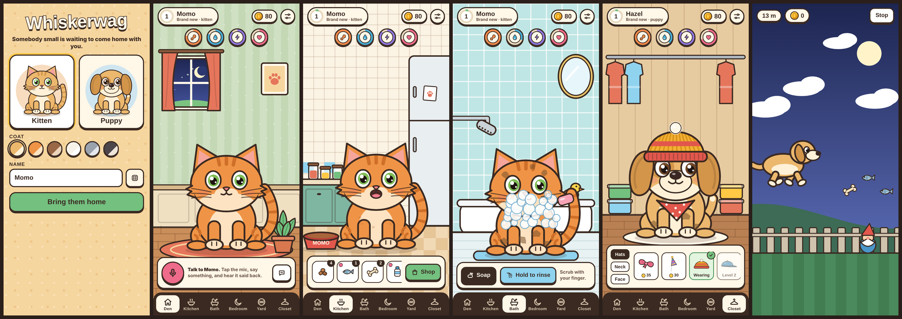
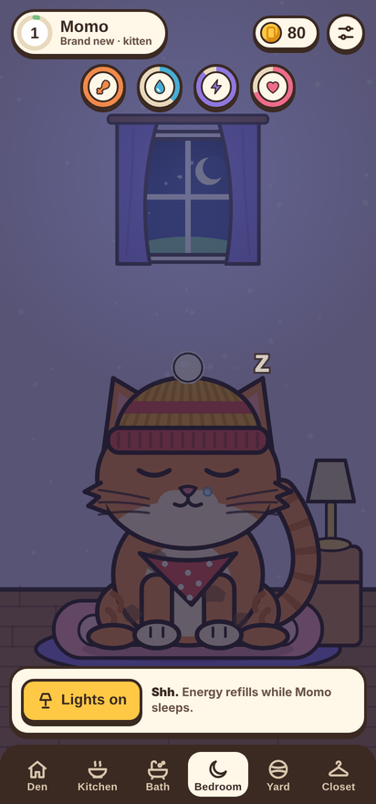
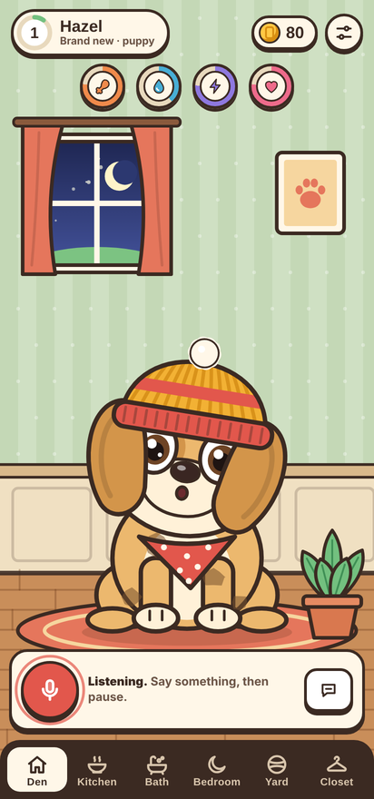
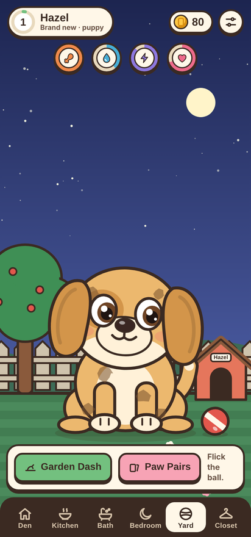
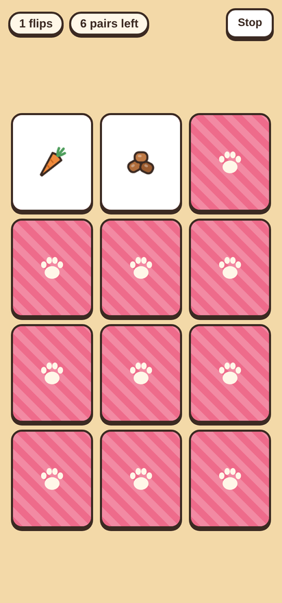

# 🐾 Whiskerwag

**Adopt a kitten or a puppy. Feed it, bathe it, tuck it in, dress it up, and teach it to talk back.**

Whiskerwag is a virtual pet game for phones and the web. You pick a pet, name it, and look after it every day. It gets hungry, muddy, sleepy, and bored, and it lets you know with a little thought bubble. Talk into the mic and it repeats you in a squeaky voice.



**▶ Play it:** https://jaineil32624.github.io/whiskerwag/

---

## ✨ What you can do

| | |
|---|---|
| 🐱🐶 **Adopt** | Choose a kitten or a puppy, one of six coats (Honey, Ginger, Cocoa, Snow, Smoke, Ink), and a name. |
| 🎤 **Talk back** | Tap the mic and say something. Your pet listens with its ears perked, then repeats you in a high, squeaky voice, and its mouth moves with the sound. No mic? Type a message instead. |
| 🍗 **Kitchen** | Drag food from the tray into your pet's mouth. Kittens love sardines and milk. Puppies love bones and drumsticks. Each pet turns up its nose at some foods. Buy groceries at the corner shop. |
| 🛁 **Bath** | Scrub with the soap to make suds, then hold the shower to rinse. Puppies shake off the water. Kittens are *not* impressed. |
| 🌙 **Bedroom** | Turn off the lamp and your pet curls up and snores. Energy refills while it sleeps, even when the app is closed. |
| 🎾 **Yard** | Flick the ball and your pet heads it back. Play two mini-games for coins: **Garden Dash**, a side-scrolling runner (jump puddles, flowerpots, and gnomes), and **Paw Pairs**, a memory card game. |
| 🎩 **Closet** | 12 accessories (hats, collars, bandanas, scarves, glasses) that unlock as your pet levels up. |
| 💗 **Pet it** | Tap the head for a giggle, stroke it for hearts, boop the nose for a sneeze. Poke the belly too many times and you'll get a growl. |

Other details:
- Stats keep ticking while you're away (up to two days' worth).
- A daily treat of coins and kibble is waiting each day.
- The windows show day or night based on your real clock.
- The pet's bowl and the doghouse have its name on them.

## 🎨 Made from scratch

There are **no image or sound files** in this project:

- 🖌️ Every pet, room, food, and accessory is drawn in code on an HTML canvas, in one hand-drawn sticker style with a consistent ink outline.
- 😺 The pet has nine expressions: idle, happy, love, sad, tired, asleep, yuck, annoyed, and surprised. It also blinks, breathes, follows your finger with its eyes, and wags or swishes its tail depending on its mood.
- 🔊 Meows, barks, purrs, growls, chomps, and bubble pops are all synthesized live with the Web Audio API.
- 🗣️ The talk-back feature detects when you start and stop speaking, records your voice, and plays it back faster and higher. That's the classic chipmunk effect.

## 🛠️ Tech

- One `index.html`: HTML, CSS, and vanilla JavaScript, with no frameworks or build step.
- Canvas 2D for all art and animation, plus the Web Audio API for sound and voice.
- An installable PWA (`manifest.json` + `sw.js`) that works offline after the first visit.
- Progress is saved in `localStorage` on the device.

## 📱 Run it

**In a browser:** open the GitHub Pages link above. On Android, use *Add to Home screen* to install it like an app.

**Locally:**
```bash
git clone https://github.com/jaineil32624/whiskerwag.git
cd whiskerwag
python3 -m http.server 8000
# open http://localhost:8000
```
The microphone needs `https://` or `localhost`.

**As an Android app for Google Play:** wrap the hosted PWA with [Bubblewrap](https://github.com/GoogleChromeLabs/bubblewrap) to get a signed `.aab` you can upload to the Play Console.
```bash
npm i -g @bubblewrap/cli
bubblewrap init --manifest https://jaineil32624.github.io/whiskerwag/manifest.json
bubblewrap build
```

## 📸 More screenshots

<p>




</p>

---

Made by **Jaineil Rana**.
